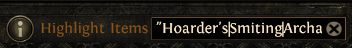
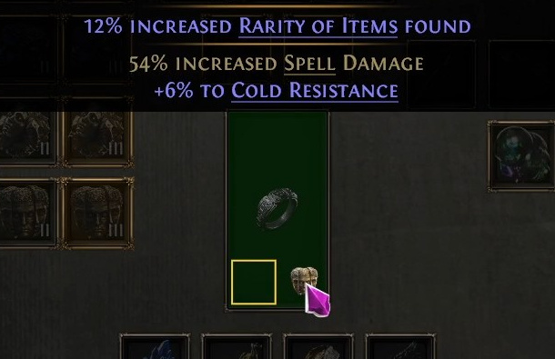
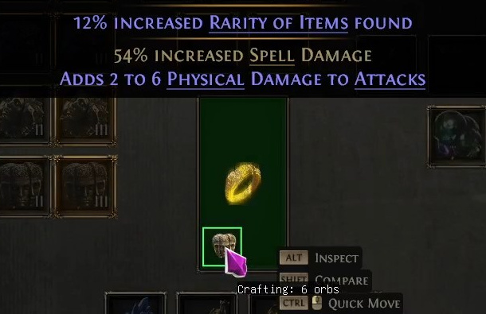
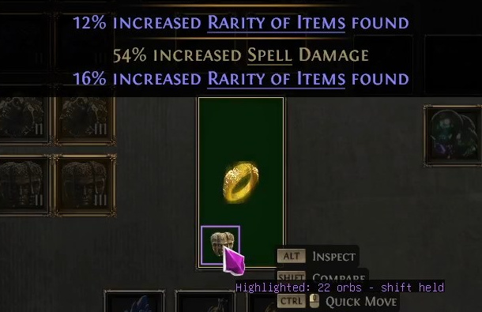

# CraftUntilHighlighted

An ExileCore2 plugin for Path of Exile 2: a lightweight crafter that applies a currency to an item until the stash search highlights it.

## Install

Install using **PluginUpdater**:

1. Add > paste this plugin's URL: `https://github.com/bnc-anonymous/CraftUntilHighlighted` > Clone
2. Add > paste ExileInput2's URL: `https://github.com/bnc-anonymous/ExileInput2` > Clone

## Usage

1. Put an item in your currency tab's crafting slot.
2. Type a regex for the modifiers you want into the stash search.

   

3. Right-click the currency you want to use. It must be on the **Allowed currencies** list in the plugin's settings (Chaos Orb, Greater Chaos Orb and the quality currencies by default).
4. Move the cursor into the square at the bottom-left of the item.

The plugin will use the currency with a randomised delay until the item is highlighted. You can then click again yourself to roll past a match. Move the cursor out of the square to stop.

**Ready**

**Crafting**

**Highlighted**

## Finding modifier names

The stash search can match a modifier's name. To find the name for a modifier, open the item class on poe2db, for example Rings: https://poe2db.tw/Rings#ModifiersCalc, click the modifier you want and use the name of the tier you are after. For example, the top tier of increased Rarity of Items found on a ring is "Hoarder's". Separate several names with `|`, as in the search above: `"Hoarder's|Smiting"` would match T1 #% increased Rarity of Items found or T1 #% increased Lightning Damage.

## License

MIT
